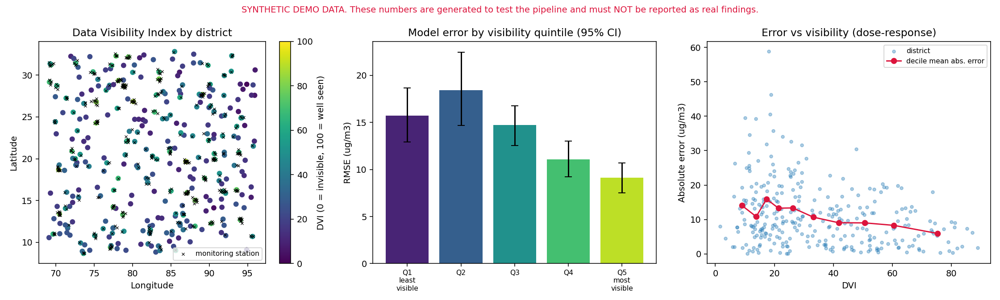

# climate-fairness-audit

**Who gets "seen" by climate models?** A reproducible toolkit to measure how unevenly Indian
districts are covered by climate and energy data, and whether models trained on that data
perform worse for poorer, rural or less-surveyed regions.

> **Status:** Phase 1 (foundation). The pipeline currently runs on **synthetic data** so every
> step is testable. Real datasets (CPCB / OpenAQ, Sentinel-5P, NFHS-5, Census/SHRUG) come next.
> Numbers produced from synthetic data are pipeline tests, **not findings**.



*Synthetic demo: left, the Data Visibility Index (DVI) by district with monitoring stations;
middle, model error by visibility quintile with 95% bootstrap CIs; right, error vs DVI.*

## What it does today

- **Data Visibility Index (DVI):** a transparent 0-100 score per district built from station
  density, distance to nearest monitor, survey sample size, data completeness and satellite
  quality. See [docs/dvi_methodology.md](docs/dvi_methodology.md).
- **Weight-sensitivity analysis:** checks that district rankings survive different weightings.
- **Group-wise fairness audit:** RMSE / MAE / bias by group (visibility quintile, settlement type,
  wealth quintile) with bootstrap confidence intervals and a Q1-vs-Q5 gap test.
- **Fairlearn adapter:** `MetricFrame` for regression metrics (optional extra).
- **One-command demo** that writes tables, a summary JSON and an overview figure.

## Quickstart

```bash
git clone <your-repo-url> && cd climate-fairness-audit
make setup                 # venv + dependencies + pre-commit hooks
source .venv/bin/activate
make test                  # 42 tests
cfa demo --out outputs     # runs the synthetic end-to-end pipeline
```

Without `make`: `python -m venv .venv && pip install -e ".[dev,fairness]"`.

## Real-data workflow (Phase 2)

```python
from cfa.data.ingest.nfhs import load_nfhs_csv
from cfa.data.ingest.stations import load_stations_csv
from cfa.geo.assign import assign_by_polygon          # or assign_by_nearest_centroid (approx.)
from cfa.data.build import build_district_table
from cfa.visibility.dvi import compute_visibility_inputs, compute_dvi

nfhs = load_nfhs_csv("nfhs5.csv", {"District Names": "district", "State": "state",
                                   "Households with electricity (%)": "hh_electricity"},
                     percent_cols=("hh_electricity",))
stations = assign_by_polygon(load_stations_csv("stations.csv", {...}), district_polygons_gdf)
districts, report = build_district_table(reference_df, stations, nfhs)   # raises if match rate < 90%
scores = compute_dvi(compute_visibility_inputs(districts, stations.dropna(subset=["district_id"])))
```

Design choices: ambiguous or weak district-name matches are left **unmatched** (never guessed) and
every match records its method; schemas check India bounds (catches swapped lat/lon) and list
all violations at once; NFHS `*` (suppressed) and `(x)` (low-n) conventions are handled explicitly.
The OpenAQ field names follow the v3 docs but were not verified against the live API.

## Use as a library

```python
from cfa.data.synthetic import generate_synthetic_data
from cfa.visibility.dvi import compute_visibility_inputs, compute_dvi, assign_quintiles
from cfa.fairness.audit import group_metrics, gap_with_ci

districts, stations = generate_synthetic_data(300, seed=42)
scores = compute_dvi(compute_visibility_inputs(districts, stations))
scores["quintile"] = assign_quintiles(scores["dvi"]).to_numpy()
# With your own predictions merged in as pm25_true / pm25_pred:
# group_metrics(df, "quintile"); gap_with_ci(df, "quintile", "Q1_least_visible", "Q5_most_visible")
```

## Repository layout

```
src/cfa/
  data/synthetic.py        synthetic districts, stations, predictions (test fixture)
  geo/distance.py          haversine + memory-bounded nearest-station distance
  visibility/dvi.py        Data Visibility Index, quintiles, sensitivity analysis
  fairness/audit.py        group metrics, bootstrap CIs, gap test, dose-response
  fairness/fairlearn_adapter.py   optional Fairlearn MetricFrame
  pipeline.py, cli.py, viz.py     end-to-end demo, CLI, figures
tests/                     pytest suite (~98% coverage)
docs/                      methodology and figures
.github/workflows/ci.yml   lint, tests, Bandit, pip-audit (read-only permissions)
```

## Roadmap

- [x] Repo, tooling, CI, security baseline
- [x] Synthetic data, DVI, sensitivity analysis, audit with CIs
- [x] Real-data layer: district crosswalk, Pandera-validated station + NFHS loaders, OpenAQ client
- [ ] Run on real files: reference district list (Census/LGD), NFHS-5 export, CPCB/OpenAQ stations
- [ ] Satellite and weather ingestion (Sentinel-5P, ERA5) + station measurement completeness
- [ ] DVC versioning, data validation (Pandera / Great Expectations), Prefect or Dagster flows
- [ ] PM2.5 models with spatial cross-validation, conformal prediction, SHAP
- [ ] Mitigation experiments and the accuracy-equity frontier
- [ ] Sensor-placement optimiser
- [ ] FastAPI service + interactive dashboard
- [ ] Blog post, model cards, datasheets, PyPI release

## Responsible use

Audit results measure **performance gaps**, not their causes, and must not be used to rank or
blame districts or agencies. District-level groups can hide within-district inequality.
Always report gaps with confidence intervals and sample sizes. See [SECURITY.md](SECURITY.md).

## Licence

MIT. Check each dataset's own licence before use or redistribution.
